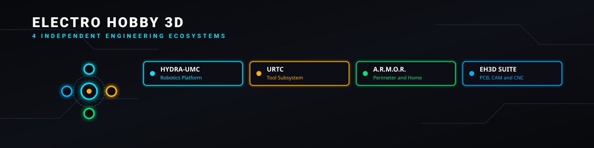
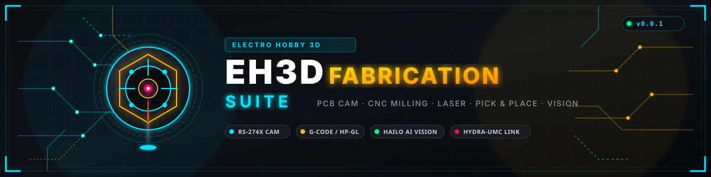

  

# Electro Hobby 3D 🤖🚀

  <a href="README.md">🇺🇸 English</a> |
  <a href="README\_spa.md">🇪🇸 Español</a> |
  <a href="README\_fra.md">🇫🇷 Français</a> |
  <a href="README\_ita.md">🇮🇹 Italiano</a> |
  <b>🇩🇪 Deutsch</b> |
  <a href="README\_zho.md">🇨🇳 简体中文</a> |
  <a href="README\_jpn.md">🇯🇵 日本語</a> |
  <a href="README\_por.md">🇵🇹 Português</a>

  
  
  

Vier unabhängige Ingenieur-Ökosysteme, ein Autor. **HYDRA-UMC** ist eine mehrschichtige industrielle Robotikplattform, die von Echtzeit-Firmware bis hin zu kognitiver KI reicht. **URTC** ist sein universelles Roboter-Werkzeug-Subsystem: Echtzeit-Firmware und Desktop-/Web-Tools für den Endeffektor eines Roboters, entwickelt als eigenständiges Produkt mit unabhängiger Versionierung und Wartungstools. **A.R.M.O.R.** ist ein separates, öffentliches Perimetersicherheits- und Heimautomatisierungs-Ökosystem – Radardraumerfassung, Solar- und Stromüberwachung sowie ein zentraler Koordinator mit Web- und Mobilclients. **EH3D Fabrication Suite** ist ein integriertes Software-Ökosystem für Leiterplatten-Prototyping, CAM-Verarbeitung, Computer-Vision-Inspektion, Pick-\&-Place-Management und CNC-/Laser-Steuerungsschnittstellen, das mit HYDRA-UMC-Hardware und spezialisierten Werkstattmaschinen verbunden ist.

## 🚦 Projektstatus

Jede Zeile ist ein Teil dieses Repositorys, und die Ampel sagt, wie weit er heute ist. Sie beruht auf dem, was das Repository zeigen kann (Tests, Builds, Läufe), nicht auf dem, was geplant ist.

🟢 Fertig und überprüft · 🟡 Funktioniert, mit bekannten Grenzen · 🟠 Teilweise fertig oder noch nicht überprüft · 🔴 Nicht gemacht oder funktioniert nicht

| Bereich | Stand | Was das hier bedeutet |
|---|---|---|
| Dashboard und Überwachung | 🟢 | Das Status-Dashboard, die CI-Überwachung, die Gesundheitsmatrix, die Linkprüfung und die Release-Übersicht laufen zeitgesteuert in GitHub Actions, und ihre letzten Läufe bestehen. |
| Tests | 🟢 | 59 Tests bestehen (`python -m unittest discover -s tests`): der Katalog, die Überwachung, die Banner, die Roadmap-Vorbefüllung der vier Boards (HYDRA-UMC, URTC, A.R.M.O.R. und EH3D) und der Gleichstand der README. |
| Katalog und Versionen | 🟢 | Version und Beschreibung jeder Projekttabelle werden von Skripten aus dem Manifest des jeweiligen Repositorys und aus einer einzigen geprüften Beschreibungsdatei gefüllt, und das CI schlägt fehl, wenn eines davon abweicht. |
| Fortschrittsbalken | 🟢 | Der Prozentwert jedes Ökosystems wird von `scripts/ecosystem_progress.py` aus der Reife und dem Nachweis berechnet, die jedes Repository in seinem eigenen Manifest angibt, dazu seine veröffentlichten Versionen, Tests, grünes CI und Dokumentation in acht Sprachen, und mit dem Dashboard erneuert; der 100%-Meilenstein bleibt ein vollständig integriertes Ökosystem auf echter Hardware. |
| Gleichstand in acht Sprachen | 🟢 | Die acht README-Dateien behalten dieselben Abschnitte, dieselben GitHub-Links und dieselbe Zahl von Tabellenzeilen, und ein Test schlägt fehl, wenn eine davon abweicht. |
| Echte Hardware | 🟢 | Nicht zutreffend: Dieses Repository enthält das Profil und seine Automatisierung, nichts hier läuft auf Hardware. |
| Dokumentation | 🟢 | README in acht Sprachen mit den vier Ökosystemen, die Anleitung zur Zusammenarbeit auf GitHub und die Community-Dateien. |

## 🧭 Über Electro Hobby 3D und seinen Updater

**Electro Hobby 3D** ist die Werkstatt von JuanenRac: Elektronik, Robotik und Software, die an einem Ort entworfen, gebaut, programmiert und getestet werden. Jedes Repository beschreibt sich mit einem Manifest, hat seine eigene Dokumentation und sagt, was auf echter Hardware erprobt wurde und was nicht.

[ELECTRO-HOBBY-3D-UPDATER](https://github.com/JuanenRac/ELECTRO-HOBBY-3D-UPDATER) ist **der Updater der vier Ökosysteme**: ein Fenster und eine Befehlszeile, die an den Updater des jeweiligen Ökosystems übergeben; diese entdecken, installieren und aktualisieren dessen Repositories. Jedes Ökosystem unten nennt seinen eigenen.

| Ökosystem | Was es ist | Updater |
|---|---|---|
| **HYDRA-UMC** | Industrierobotik und Maschinensteuerung, von der Echtzeit-Firmware bis zur kognitiven KI | [HYDRA-UMC-UPDATER](https://github.com/JuanenRac/HYDRA-UMC-UPDATER) |
| **URTC** | Firmware und Werkzeuge für die Endeffektoren eines Roboters | [URTC-UPDATER](https://github.com/JuanenRac/URTC-UPDATER) |
| **A.R.M.O.R.** | Perimeterschutz und Hausautomation | [ARMOR-UPDATER](https://github.com/JuanenRac/ARMOR-UPDATER) |
| **EH3D Fabrication Suite** | Leiterplatten-Prototyping, CAM, CNC und Laser, Pick and Place | [EH3D-UPDATER](https://github.com/JuanenRac/EH3D-UPDATER) |

Eine fünfte Gruppe, **Werkzeuge (Tools)**, hat unten einen eigenen Abschnitt.

\---

# 🐙 HYDRA-UMC

  

  
  
  

Willkommen im **HYDRA-UMC-Ökosystem**, einer mehrschichtigen industriellen Robotikplattform, die von hardwarenaher Echtzeit-Firmware bis hin zu kognitiver KI auf hoher Ebene reicht. Diese Organisation beherbergt viele spezialisierte Projekte, die für die Automatisierung von Mikrofabriken und Schwarmrobotik perfekt synchronisiert arbeiten.

**Updater:** [HYDRA-UMC-UPDATER](https://github.com/JuanenRac/HYDRA-UMC-UPDATER) erkennt, installiert und aktualisiert die Repositories dieses Ökosystems; [ELECTRO-HOBBY-3D-UPDATER](https://github.com/JuanenRac/ELECTRO-HOBBY-3D-UPDATER) tut das für alle vier.

## 📈 Ökosystem-Fortschritt

<!-- progress:hydra-umc -->
`\[███████████░░░░░░░░░] 55%` — Aus realen Daten berechnet: die Reife und der Nachweis, die jedes seiner 59 Repositories in seinem eigenen Manifest angibt, dazu seine veröffentlichten Versionen, seine Tests, sein grünes CI und seine Dokumentation in acht Sprachen. Der 100%-Meilenstein ist ein vollständig integriertes Ökosystem auf echter Hardware.
<!-- /progress:hydra-umc -->

<!-- status:hydra-umc -->
### 🚦 Status des Ökosystems

Für das gesamte Ökosystem aus realen Daten berechnet, nie von Hand; eine Ampel wird ab 90 % der Repositories grün, ab 60 % gelb und ab 30 % orange.

| Bereich | Status | Fortschritt | Hinweis |
| --- | :---: | --- | --- |
| Software | 🟢 | `█████████▌ 95%` | 56 von 59 Repositories sind mindestens funktionsfähig, nach der Reife, die jedes in seinem eigenen Manifest angibt. |
| Tests | 🟢 | `█████████▊ 98%` | 58 von 59 Repositories haben automatische Tests. |
| Kontinuierliche Integration | 🟢 | `██████████ 100%` | 59 von 59 Repositories haben den letzten CI-Lauf auf dem Hauptzweig grün. |
| Veröffentlichte Versionen | 🟢 | `██████████ 100%` | 59 von 59 Repositories haben mindestens eine Version veröffentlicht. |
| Dokumentation | 🟢 | `██████████ 100%` | 59 von 59 Repositories haben die README in den acht Sprachen. |
| Simulation | 🔴 | `██▊░░░░░░░ 27%` | 16 von 59 Repositories wurden mindestens in einem Simulator geprüft. |
| Echte Hardware | 🔴 | `█▏░░░░░░░░ 11%` | 4 der 38 Repositories, die von Hardware abhängen, wurden auf dem Prüfstand oder im Feld geprüft; der Rest lief nie mit der echten Ausrüstung. |
| Produktion | 🔴 | `▊░░░░░░░░░ 8%` | 5 von 59 Repositories sind etabliert oder im Produktivbetrieb. |
<!-- /status:hydra-umc -->

> \[!IMPORTANT]
> 🛠️ \*\*Projekt pausiert — physische Hardware wird gebaut.\*\* Die aktive Entwicklung ruht, während die physische Robotikzelle (Rahmen, Verkabelung, die echten CM5- und STM32-Platinen) real aufgebaut wird. So hat die nächste Arbeitsphase echte Hardware zum Ausführen und Validieren, anstatt nur eines Balkens, der nach oben geht. Die Arbeit wird fortgesetzt, sobald dieser Aufbau steht.

\---

## 🚀 Hauptmerkmale und Skalierbarkeit

* **Multi-Roboter-Skalierbarkeit**: Unterstützt bis zu 8 verteilte Robotereinheiten (derzeit 3, 4, 5 und 6 DOF; Skalierung auf 7, 8, 9 DOF und Dual-Robot-Architekturen in zukünftigen Versionen).
* **Integrierte lokale Stufe**: Die Hauptplatine von HYDRA-UMC verfügt über eine integrierte **6-Achsen-Lokale-Stufe** für Hilfsaufgaben, einschließlich sekundärer Roboter, ATC-Revolvern (Automatic Tool Changer), Förderbandsynchronisation oder XYZ-Tischportalen.

\---

## 🏗️ Ökosystem-Architektur

Das v1.1-Ökosystem ist eine geschichtete Produktplattform: Es baut auf etablierter Linux- und Raspberry Pi-Technologie auf, anstatt ein neues Betriebssystem zu entwickeln oder Hersteller-APIs zu ersetzen.

1. **Plattformbasis**: Raspberry Pi OS ARM64 und Standard-Linux-Dienste bilden die unterstützte CM5-Grundlage.
2. **Plattform und Verträge**: **HYDRA-UMC-OS** verpackt reproduzierbare Profile, Dienste, Diagnosen und Updates auf Raspberry Pi OS; **HYDRA-UMC-SDK** veröffentlicht versionierte Verträge, Thin Clients und Konformitätstests.
3. **Echtzeitausführung**: Die **HYDRA-UMC**-Firmware verwaltet Bewegungslimits, Watchdogs und sicheren Stopp auf STM32/MCU; das Werkzeug selbst und seine eigene Echtzeit-Autorität über den Endeffektor gehören zum separaten **URTC**-Ökosystem unten.
4. **Koordination und Betrieb**: Serverdienste, Auftragsdisposition, Telemetrie und Konfiguration koordinieren Geräte, ohne die MCU-Sicherheitsgrenze zu umgehen.
5. **Bedienerschnittstellen**: Studio-, Suite-, DSI-, Web-, Desktop-, Mobil- und CLI-Clients verwenden die SDK-Verträge.
6. **Wahrnehmung und Intelligenz**: Vision-, Hailo- und kognitive Dienste schlagen Beobachtungen oder Pläne vor; sie haben keine physische Sicherheitsautorität.
7. **Ingenieurwesen, Industrie und Daten**: Digitaler Zwilling, HIL/Physik, OPC-UA/MQTT/MTConnect-Gateways und Datendienste validieren und integrieren das System.

Beginnen Sie für Implementierungsanleitungen mit der öffentlichen Architektur- und Servicedokumentation in **HYDRA-UMC-OS** und verwenden Sie dann die Verträge und Konformitätsregeln in **HYDRA-UMC-SDK**. Die MCU-Sicherheitsautorität wird bei jedem Ablauf gewahrt.

\---

## 🛠️ Technologiestack und Tools

Das Ökosystem nutzt einen modernen, leistungsstarken Stack für mission-critical Zuverlässigkeit:

### 💠 Eingebettet und Echtzeit (Ausführung)

* **Mikrocontroller**: STM32H745 (Dual-Core 480MHz), STM32G474 (170MHz), STM32F303.
* **Frameworks**: FreeRTOS (AMP-Modus), CMSIS-DSP, STM32 HAL/LL.
* **Protokolle**: FDCAN (1Mbps/5Mbps), CAN-OTA, SPI (50MHz Slave IPC), I2C, UART.
* **Kinematik**: S-Kurven-Profilgenerierung, Echtzeit-Inverskinematik (IK).

### 🧠 Edge KI und Wahrnehmung (Intelligenz)

* **Beschleuniger**: Hailo-8 (26 TOPS) für 8x Kameravision, Hailo-10 (40 TOPS) für GenAI.
* **Modelle**: YOLOv10 (Erkennung), OpenVLA (Aktion), Whisper (Sprache), Llama-3 (Schlussfolgerung).
* **Zwischenknoten**: gRPC über Protobuf und High-Speed-SPI-DMA-Metadatenaustausch.

### 🌐 Backend und Koordination (Koordination)

* **Runtimes**: Node.js 20+ (API), Rust 1.80+ (Orchestrator), Go (CLI).
* **Infrastruktur**: Express, Fastify, Socket.io (WebSocket), gRPC.
* **Datenbank**: InfluxDB/TimescaleDB (Telemetrie), Redis (Status), SQLite.

### 💻 Dashboards und Benutzeroberfläche (Schnittstelle)

* **Web**: React 19, Vite, Three.js (3D-Ansichtsfenster), Tailwind CSS.
* **Nativ**: Python 3.12/PySide6 (Suite), Kotlin (Android Nativ), Flutter 3.x (iOS \& DSI).

\---

## 📋 Systemanforderungen

* **Rechenknoten**: Raspberry Pi CM5 (4 GB+ RAM) mit NVMe-/eMMC-Speicher.
* **KI-Hardware**: Hailo-8 / Hailo-10 M.2-Module (Key M).
* **Feldbus**: Gigabit-Ethernet für LAN und FDCAN (ISO 11898-1:2015) für Aktoren.
* **Client-Betriebssystem**: Android 10+, iOS 15+, Windows 10/11 (High-DPI), Ubuntu 22.04 LTS.

\---

## 🔒 Industrielle Sicherheit

* **E-STOP-Schicht**: Fest verdrahtete Notfallleitung + Prioritäre CAN-Notfall-Frames (<1ms).
* **KI-Sicherheit**: 3D-Sicherheitszonen mit automatischem Motor-Drehmoment-Stopp bei menschlichem Eindringen.
* **Cybersicherheit**: JWT-basierte zustandslose Authentifizierung + mTLS für sicheren Zwischenknotenverkehr.
* **Integrität**: Nichtflüchtiges F-RAM für Werkzeuglebenszyklus-Audit und Statuswiederherstellung.

\---

## 🔧 Hardware-Hacking: Bauen Sie Ihren eigenen Carrier

Die Roboter-Controller-Platine basiert auf einem **Raspberry Pi CM5**, und der duale Hirose DF40-Anschluss des CM5 ist eine feste, offizielle, öffentliche Pinbelegung (Tabelle 5 des offiziellen CM5-Datenblatts von Raspberry Pi) – nichts, was dieses Projekt definiert. Das bedeutet, dass ein kompatibler Träger von Drittanbietern ein reales, machbares Projekt ist und keine Reverse-Engineering-Übung:

* **Hier beginnen**: [`HYDRA-UMC/docs/PINOUT\_CM5\_CARRIER.TXT`](https://github.com/JuanenRac/HYDRA-UMC/blob/main/docs/PINOUT_CM5_CARRIER.TXT) – welche der festen Pins des CM5 diese Platine tatsächlich verwendet (Ethernet, die 2 nativen USB3 SuperSpeed PHYs, die CM5-seitige Lüfter-Stiftleiste) und warum, nach Funktion aus der offiziellen Pinbelegungstabelle neu geordnet.
* **Der einfache Einstieg**: Die standardmäßige **Raspberry Pi 40-Pin-GPIO-Stiftleiste** (dasselbe „B+“-Layout, unverändert seit 2014) ist auf dieser Platine genau wie bei jedem Raspberry Pi herausgeführt – bestehende RPi-HATs und GPIO-Tools funktionieren unverändert. Einige Positionen, die die STM32-Verbindung dieser Platine bereits verwendet, sind aufgedruckt/vermerkt, damit Sie wissen, welche übersprungen werden müssen.
* **Weitergehen**: [`docs/architecture.md`](https://github.com/JuanenRac/HYDRA-UMC/blob/main/docs/architecture.md) beschreibt, wie der CM5, das STM32H745 „Kinematic Brain“ und der STM32G474 „Robot Controller“ tatsächlich miteinander kommunizieren (SPI1 + FDCAN1 + das CM7↔CM4 IPC-Postfach) – die Schicht, die ein Carrier-Redesign beibehalten muss, wenn es kompatibel bleiben soll mit der Firmware dieses Projekts.
* Jedes Pinbelegungsdokument gibt klar an, ob es **BESTÄTIGT** (direkt aus einer offiziellen Datenblatttabelle übernommen) oder **VGESCHLAGEN** ist (die eigene Routing-Wahl dieses Projekts, offen für eine andere auf einem abgeleiteten Carrier) – lesen Sie diese Statuszeile, bevor Sie eine Signalzuordnung als fest betrachten.

Dies ist kein geführtes Tutorial (es gibt keinen einzigen „richtigen“ Carrier für jeden Anwendungsfall) – es ist das reale Referenzmaterial, das ein erfahrener Hardwaredesigner benötigt, um von einer bekannten, guten Pin-Map anstelle eines reinen Datenblatts aus zu starten.

\---

## 📁 HYDRA-UMC Projektkatalog

Neu im Ökosystem? `./starter-kit.sh` (oder `starter-kit.bat` unter Windows) klont 13 Kern-Repositories – ein handverlesenes Startset – als Geschwister in einem Verzeichnis: das Standardlayout, das jedes skriptübergreifende Repo hier bereits voraussetzt. Ein zweites Argument klont stattdessen ein ganzes Ökosystem, das live anhand seines Manifests entdeckt wird: `hydra-umc`, `urtc`, `armor`, `eh3d` oder `all` (zum Beispiel `./starter-kit.sh \~/work armor`). Ein erneutes Ausführen ist sicher: Bereits geklonte Elemente bleiben unverändert. Von dort aus kann der Updater jedes Ökosystems – oder [ELECTRO-HOBBY-3D-UPDATER](https://github.com/JuanenRac/ELECTRO-HOBBY-3D-UPDATER) für alle vier – Versionen überprüfen und jedes andere Projekt erstellen/aktualisieren.

### 🧱 Plattform-Grundlage und Verträge

|Repository|Version|Beschreibung|
|-|-|-|
|[HYDRA-UMC-OS](https://github.com/JuanenRac/HYDRA-UMC-OS)|0.6.1|Plattformschicht auf Raspberry Pi OS für das CM5: Profile, Konfiguration, Diagnose, Dienste und Updates; keine neue Distribution.|
|[HYDRA-UMC-SDK](https://github.com/JuanenRac/HYDRA-UMC-SDK)|0.6.1|Geteilte versionierte Verträge, Thin Clients und Konformitätstests für Dienste, Benutzeroberflächen und CM5-Adapter; ersetzt keine Hersteller-APIs.|
|[HYDRA-UMC-CONNECTOR-HUB](https://github.com/JuanenRac/HYDRA-UMC-CONNECTOR-HUB)|0.1.9|Deklaratives Register und Validator für Adapter-Manifeste von Konnektoren externer Maschinen.|

### 💠 Kernsteuerung und Bediener-Clients

|Repository|Version|Beschreibung|
|-|-|-|
|[HYDRA-UMC](https://github.com/JuanenRac/HYDRA-UMC)|0.2.8|Kern-Bewegungssteuerungs-Firmware für STM32H745/G474 mit S-Kurven-Kinematik.|
|[HYDRA-UMC-SERVER](https://github.com/JuanenRac/HYDRA-UMC-SERVER)|0.8.2.9|Headless Node.js-API und WebSocket-Backend für die robotergestützte Orchestrierung.|
|[HYDRA-UMC-STUDIO](https://github.com/JuanenRac/HYDRA-UMC-STUDIO)|0.8.1.9|Fortgeschrittenes React-basiertes Web-Dashboard zur 3D-Roboterüberwachung und -steuerung.|
|[HYDRA-UMC-STUDIO-KIT](https://github.com/JuanenRac/HYDRA-UMC-STUDIO-KIT)|0.0.4|Gemeinsames TypeScript-Kit der HYDRA-UMC-Webclients: Sitzung, HTTP-Client, Verbindungsverlauf, Einstellungen und Rundgänge.|
|[HYDRA-UMC-SUITE](https://github.com/JuanenRac/HYDRA-UMC-SUITE)|0.8.0.5|Leistungsstarke Python/Qt-Desktop-Anwendung für die Industrieautomation.|
|[HYDRA-UMC-DSI](https://github.com/JuanenRac/HYDRA-UMC-DSI)|0.3.6|Dedizierte Flutter-basierte Touch-Schnittstelle für 7"-Industrieprodukte (CM5).|
|[HYDRA-UMC-ANDROID-CONTROL](https://github.com/JuanenRac/HYDRA-UMC-ANDROID-CONTROL)|0.8.0.3|Native Kotlin-Mobil-App mit biometrischem Login für die Fernverwaltung von Robotern.|
|[HYDRA-UMC-IOS-CONTROL](https://github.com/JuanenRac/HYDRA-UMC-IOS-CONTROL)|0.3.5|Flutter-Mobil-App für iOS/iPadOS mit Echtzeit-WebSocket-Synchronisierung.|
|[HYDRA-UMC-EDITOR-URDF](https://github.com/JuanenRac/HYDRA-UMC-EDITOR-URDF)|0.2.0|Grafischer URDF-Editor zum Validieren und Hochladen von Robotermodellen in den Katalog.|
|[HYDRA-UMC-EDITOR-STL](https://github.com/JuanenRac/HYDRA-UMC-EDITOR-STL)|0.2.1|Desktop-STL-Modell-Editor – Transformieren, Ersetzen, Entfernen und Hinzufügen realer Teile im gemeinsamen Modellkatalog.|
| [HYDRA-UMC-MESHES](https://github.com/JuanenRac/HYDRA-UMC-MESHES) | 0.1.0 | Gemeinsame 3D-Netze (STL und GLB) der Desktop- und Web-Apps, einmal als Release-Paket mit Prüfsummen veröffentlicht. |

### 👁️ Vision-KI-Knoten (Optimiert für Hailo-8)

|Repository|Version|Beschreibung|
|-|-|-|
|[HYDRA-UMC-VISION-NODE](https://github.com/JuanenRac/HYDRA-UMC-VISION-NODE)|0.2.3|Hochgeschwindigkeits-Wahrnehmungsknoten für 8 gleichzeitige USB 3.0-Kameraströme.|
|[HYDRA-UMC-VISION-STREAMER](https://github.com/JuanenRac/HYDRA-UMC-VISION-STREAMER)|0.2.6|Optimierte GStreamer/MediaMTX-Pipeline für die industrielle Videoübertragung.|
|[HYDRA-UMC-DETECTION-HEF](https://github.com/JuanenRac/HYDRA-UMC-DETECTION-HEF)|0.2.0|Bibliothek hardwarebeschleunigter YOLO-Modelle für SMD- und Bauteil-QS.|
|[HYDRA-UMC-SAFETY-ZONES](https://github.com/JuanenRac/HYDRA-UMC-SAFETY-ZONES)|0.2.4|Echtzeit-KI-Einbrucherkennung für den Schutz des Roboter-Arbeitsvolumens.|
|[HYDRA-UMC-VISUAL-SERVOING-API](https://github.com/JuanenRac/HYDRA-UMC-VISUAL-SERVOING-API)|0.2.4|Bildbasiertes kinematisches Feedback für eine Posenkorrektur im Submillimeterbereich.|

### 🧠 Kognitiver KI-Knoten (Optimiert für Hailo-10)

|Repository|Version|Beschreibung|
|-|-|-|
|[HYDRA-UMC-COGNITIVE-NODE](https://github.com/JuanenRac/HYDRA-UMC-COGNITIVE-NODE)|0.2.1|Semantischer Argumentationsknoten für logische Missionsplanung und Sprachsteuerung.|
|[HYDRA-UMC-VLA-ENGINE](https://github.com/JuanenRac/HYDRA-UMC-VLA-ENGINE)|0.2.3|Vision-Language-Action-Modellimplementierung für komplexe Aufgabenabläufe.|
|[HYDRA-UMC-VOICE-UI](https://github.com/JuanenRac/HYDRA-UMC-VOICE-UI)|0.2.4|Lokale, private STT/TTS-Pipeline für natürliche Sprachinteraktion mit dem Bediener.|
|[HYDRA-UMC-SEMANTIC-PLANNER](https://github.com/JuanenRac/HYDRA-UMC-SEMANTIC-PLANNER)|0.2.0|LLM-basierter Missions-Orchestrator mit kontextbewusster Fehlerbehebung.|
|[HYDRA-UMC-DOCS-QA](https://github.com/JuanenRac/HYDRA-UMC-DOCS-QA)|0.1.8|RAG-basierter KI-Assistent, trainiert auf technischen Handbüchern und Quellcode.|
|[HYDRA-UMC-LOCAL-TECHNICIAN](https://github.com/JuanenRac/HYDRA-UMC-LOCAL-TECHNICIAN)|0.2.2|Lokaler KI-Wartungstechniker mit Richtlinien: Risikostufen und Werkzeug-Allowlist; ein abgerufenes Dokument kann nie einen Werkzeugaufruf auslösen.|

### 🐝 Orchestrierung und Schwarm

|Repository|Version|Beschreibung|
|-|-|-|
|[HYDRA-UMC-ORCHESTRATOR](https://github.com/JuanenRac/HYDRA-UMC-ORCHESTRATOR)|0.2.6|Flottenmanager für Multi-Roboter-Koordination und Kollisionsvermeidung.|
|[HYDRA-UMC-SWARM-SYNC](https://github.com/JuanenRac/HYDRA-UMC-SWARM-SYNC)|0.2.0|PTP-Synchronisation (Precision Time Protocol) für Roboter-Synchronisation im Nanosekundenbereich.|
|[HYDRA-UMC-PATH-PLANNER-3D](https://github.com/JuanenRac/HYDRA-UMC-PATH-PLANNER-3D)|0.1.4|Verteilter Pfadoptimierer für Roboter-Schwärme in gemeinsamen Arbeitsbereichen.|
|[HYDRA-UMC-JOB-DISPATCHER](https://github.com/JuanenRac/HYDRA-UMC-JOB-DISPATCHER)|0.3.0|Prioritätsbasierter Task-Scheduler für heterogene Roboterflotten.|
|[HYDRA-UMC-NODE-HEALING](https://github.com/JuanenRac/HYDRA-UMC-NODE-HEALING)|0.2.5|Hochverfügbarkeitsmonitor mit transparentem Missions-Failover.|

### 🎮 Digitaler Zwilling und Simulation

|Repository|Version|Beschreibung|
|-|-|-|
|[HYDRA-UMC-TWIN](https://github.com/JuanenRac/HYDRA-UMC-TWIN)|0.1.8|High-Fidelity-Physiksimulations-Engine für risikofreie Robotertests.|
|[HYDRA-UMC-PHYSICS-REPLICA](https://github.com/JuanenRac/HYDRA-UMC-PHYSICS-REPLICA)|0.1.4|Echtwelt-Physiksimulation (MuJoCo/PhysX) von URDF-Ketten.|
|[HYDRA-UMC-HIL-BRIDGE](https://github.com/JuanenRac/HYDRA-UMC-HIL-BRIDGE)|0.1.6|Hardware-in-the-Loop-Schnittstelle für die Befehlssynchronisierung zwischen Real und Virtuell.|
|[HYDRA-UMC-SYNTHETIC-DATA-GEN](https://github.com/JuanenRac/HYDRA-UMC-SYNTHETIC-DATA-GEN)|0.1.5|Prozeduraler Generator von Trainingsdatensätzen für Vision-Knoten.|

### 📊 Daten und Analytik

|Repository|Version|Beschreibung|
|-|-|-|
|[HYDRA-UMC-DATALAKE](https://github.com/JuanenRac/HYDRA-UMC-DATALAKE)|0.2.6|Big-Data-Speicher für massive industrielle Robotikdaten.|
|[HYDRA-UMC-TELEMETRY-COLLECTOR](https://github.com/JuanenRac/HYDRA-UMC-TELEMETRY-COLLECTOR)|0.2.1|Hochdurchsatz-Ingester für CAN, WebSocket und Systemprotokolle.|
|[HYDRA-UMC-ANOMALY-DETECTOR](https://github.com/JuanenRac/HYDRA-UMC-ANOMALY-DETECTOR)|0.2.3|Predictive-Maintenance-Engine basierend auf Motorschwingungssignaturen.|
|[HYDRA-UMC-PRODUCTION-REPORTS](https://github.com/JuanenRac/HYDRA-UMC-PRODUCTION-REPORTS)|0.2.1|Automatisierte OEE- und KPI-Generierung für die Industrieanlagenverwaltung.|

### 🏭 Industrie-Gateway

|Repository|Version|Beschreibung|
|-|-|-|
|[HYDRA-UMC-GATEWAY-INDUSTRIAL](https://github.com/JuanenRac/HYDRA-UMC-GATEWAY-INDUSTRIAL)|0.2.0|Industrie 4.0-Interoperabilitätsbrücke für Fabrikstandards (OPC-UA/MQTT).|
|[HYDRA-UMC-OPCUA-SERVER](https://github.com/JuanenRac/HYDRA-UMC-OPCUA-SERVER)|0.2.7|Zuordnung von HydraState-Roboterobjekten zu Standard-OPC-UA-Knoten.|
|[HYDRA-UMC-MQTT-BROKER](https://github.com/JuanenRac/HYDRA-UMC-MQTT-BROKER)|0.2.1|Telemetriebrücke für IoT-Integrationen und externe Dashboards.|
|[HYDRA-UMC-MTCONNECT-ADAPTER](https://github.com/JuanenRac/HYDRA-UMC-MTCONNECT-ADAPTER)|0.2.3|Standardisierte Schnittstelle für die Maschinenwerkzeug- und Roboter-Gesundheitsüberwachung.|

### 🌉 Externe Automatisierungsbrücken

|Repository|Version|Beschreibung|
|-|-|-|
|[HYDRA-UMC-BRIDGE-ROS2](https://github.com/JuanenRac/HYDRA-UMC-BRIDGE-ROS2)|0.1.7|Bidirektionale ROS 2-Koordinationsgrenze: Topics für Beobachtung, Services für Inspektion und abbrechbare Aktionen für Zellenjobs.|
|[HYDRA-UMC-BRIDGE-OPENPNP](https://github.com/JuanenRac/HYDRA-UMC-BRIDGE-OPENPNP)|0.2.5|Nachverfolgbarer Leiterplatten-Übergabekoordinator für OpenPnP und robotergestütztes Be- oder Entladen.|
|[HYDRA-UMC-BRIDGE-PRINTER3D](https://github.com/JuanenRac/HYDRA-UMC-BRIDGE-PRINTER3D)|0.2.3|Sichere Brücke um native 3D-Druckersoftware; erster Adapter validiert die Moonraker-Bereitschaft, ohne die Firmware zu ersetzen.|
|[HYDRA-UMC-BRIDGE-CNC](https://github.com/JuanenRac/HYDRA-UMC-BRIDGE-CNC)|0.2.6|Hilfskoordinator für CNC-Zellen; Reglerbahn und Maschinensicherheit bleiben nativ.|
|[HYDRA-UMC-BRIDGE-LASER](https://github.com/JuanenRac/HYDRA-UMC-BRIDGE-LASER)|0.2.3|Hilfskoordinator für Laserzellen, der Lasersicherheitskreise weder scharfschalten, abfeuern noch übersteuern kann.|
|[HYDRA-UMC-BRIDGE-DROIDS](https://github.com/JuanenRac/HYDRA-UMC-BRIDGE-DROIDS)|0.1.6|Koordinationsgrenze für Lauf- und Humanoid-Droiden: benannte Geh-, Greif- und Platzieraktionen, abgesichert durch den gemeinsamen Sicherheitsvertrag.|
|[HYDRA-UMC-BRIDGE-AMR](https://github.com/JuanenRac/HYDRA-UMC-BRIDGE-AMR)|0.1.9|Koordinationsgrenze für AGV/AMR-Flotten: Koordinatentransformation und ein Auftragsvokabular; die Pfadplanung bleibt bei der eigenen Navigation des AMR.|
|[HYDRA-UMC-BRIDGE-UAV](https://github.com/JuanenRac/HYDRA-UMC-BRIDGE-UAV)|0.2.1|Koordinationsgrenze für kamerabewehrte UAVs: benanntes Fluganfragevokabular plus ein deterministischer Heartbeat-/Link-Loss-Fehlsicherungs-Watchdog.|

### 🛠️ Ergänzende Tools

|Repository|Version|Beschreibung|
|-|-|-|
|[HYDRA-UMC-WATCH](https://github.com/JuanenRac/HYDRA-UMC-WATCH)|0.3.2|Tragbares Notfalldashboard mit haptischen Sicherheitswarnungen.|
|[HYDRA-UMC-TOOL-CLI](https://github.com/JuanenRac/HYDRA-UMC-TOOL-CLI)|0.2.1|Befehlszeilenschnittstelle für Flottenautomatisierung, Flashen und DevOps.|
|[HYDRA-UMC-DASHBOARD-AI](https://github.com/JuanenRac/HYDRA-UMC-DASHBOARD-AI)|0.2.4|KI-Erweiterung für Web-Dashboards, die Einblicke in natürlicher Sprache bietet.|
|[HYDRA-UMC-UPDATER](https://github.com/JuanenRac/HYDRA-UMC-UPDATER)|0.5.8|Plattformübergreifendes GUI/CLI-Tool zum Erkennen, Installieren und manuellen Aktualisieren aller Ökosystemprojekte.|
|[HYDRA-UMC-OS-REBUILDER](https://github.com/JuanenRac/HYDRA-UMC-OS-REBUILDER)|0.3.7|Desktop-Werkzeug für Windows und Linux, das ein flashbereites CM5-Image mit den aktuellen Versionen des Ökosystems und Ersteinrichtung baut.|
|[HYDRA-UMC-OPS-AGENT](https://github.com/JuanenRac/HYDRA-UMC-OPS-AGENT)|0.2.3|Koordinator für Wartungsvorfälle: sammelt einen bereinigten Zustandsbericht und fragt einen KI-Anbieter nach einer Diagnose; wendet nie einen Patch an.|
|[HYDRA-UMC-DEVELOPER-NODE](https://github.com/JuanenRac/HYDRA-UMC-DEVELOPER-NODE)|0.0.3|Entwicklerknoten: prüft Störungsnachweise, führt freigegebene Reproduktionsfälle aus und hält einen Cache von Checkouts pro Revision.|
|[HYDRA-UMC-DEV-SERVER](https://github.com/JuanenRac/HYDRA-UMC-DEV-SERVER)|0.2.5|Reproduzierbarer Entwicklungshost: richtliniengesteuerte Konfiguration und Manifest-Inventar, wachsend zu einem isolierten Task-Runner; standardmäßig ohne Deploy-Recht.|
|[HYDRA-UMC-DOCS](https://github.com/JuanenRac/HYDRA-UMC-DOCS)|0.1.3|Architektur, Schnittstellen, Sicherheitsbasis, Fähigkeitsmatrix und generierter Projektkatalog des Ökosystems sowie Vergleichswerkzeuge.|

\---

# 🔧 URTC

  

  
  
  

**URTC (Universal Robot Tool Controller)** ist ein eigenständiges Produkt und kein HYDRA-UMC-Subsystemordner: Echtzeit-Firmware und eine Familie von Desktop-/Web-Tools für den Endeffektor eines Roboters, unabhängig entwickelt, versioniert und gewartet. Ein mit URTC ausgestatteter Werkzeugwechsler koordiniert sich über FDCAN mit dem Zellcontroller von HYDRA-UMC, aber das Echtzeitverhalten, der Watchdog und der sichere Zustand des Werkzeugs unterliegen der alleinigen Autorität von URTC – der Zellcontroller kann sie nicht umgehen, und URTC ist nicht von HYDRA-UMC abhängig, um entwickelt, geflasht oder diagnostiziert zu werden.

**Updater:** [URTC-UPDATER](https://github.com/JuanenRac/URTC-UPDATER) erkennt, installiert und aktualisiert die Repositories dieses Ökosystems; [ELECTRO-HOBBY-3D-UPDATER](https://github.com/JuanenRac/ELECTRO-HOBBY-3D-UPDATER) tut das für alle vier.

<!-- progress:urtc -->
`\[███████████▎░░░░░░░░] 56%` — Aus realen Daten berechnet: die Reife und der Nachweis, die jedes seiner 11 Repositories in seinem eigenen Manifest angibt, dazu seine veröffentlichten Versionen, seine Tests, sein grünes CI und seine Dokumentation in acht Sprachen. Der 100%-Meilenstein ist ein vollständig integriertes Ökosystem auf echter Hardware.
<!-- /progress:urtc -->

<!-- status:urtc -->
### 🚦 Status des Ökosystems

Für das gesamte Ökosystem aus realen Daten berechnet, nie von Hand; eine Ampel wird ab 90 % der Repositories grün, ab 60 % gelb und ab 30 % orange.

| Bereich | Status | Fortschritt | Hinweis |
| --- | :---: | --- | --- |
| Software | 🟡 | `████████▎░ 82%` | 9 von 11 Repositories sind mindestens funktionsfähig, nach der Reife, die jedes in seinem eigenen Manifest angibt. |
| Tests | 🟢 | `██████████ 100%` | 11 von 11 Repositories haben automatische Tests. |
| Kontinuierliche Integration | 🟢 | `██████████ 100%` | 11 von 11 Repositories haben den letzten CI-Lauf auf dem Hauptzweig grün. |
| Veröffentlichte Versionen | 🟢 | `██████████ 100%` | 11 von 11 Repositories haben mindestens eine Version veröffentlicht. |
| Dokumentation | 🟢 | `██████████ 100%` | 11 von 11 Repositories haben die README in den acht Sprachen. |
| Simulation | 🟡 | `████████▎░ 82%` | 9 von 11 Repositories wurden mindestens in einem Simulator geprüft. |
| Echte Hardware | 🔴 | `░░░░░░░░░░ 0%` | 0 der 9 Repositories, die von Hardware abhängen, wurden auf dem Prüfstand oder im Feld geprüft; der Rest lief nie mit der echten Ausrüstung. |
| Produktion | 🔴 | `▉░░░░░░░░░ 9%` | 1 von 11 Repositories sind etabliert oder im Produktivbetrieb. |
<!-- /status:urtc -->

## 🏗️ Funktionsweise von URTC

1. **Werkzeug-Firmware**: Die eigene STM32-Firmware von URTC führt über 25+ spezialisierte Werkzeugprofile aus (Greifer, Dosierer, Sonden, Spindeln und mehr), jedes mit eigenen Timings, Grenzwerten und Fehlerverhalten.
2. **Feld-Update**: CAN-OTA überträgt ein neues Firmware-Image über denselben CAN-Bus, den das Werkzeug bereits verwendet, mit einem vollständigen SWD/JTAG-Pfad (URTC-FLASHER) als Fallback, der niemals von der eigenen Firmware des Werkzeugs abhängig ist.
3. **Live-Diagnose**: URTC-TESTER validiert das Echtzeit-CAN-Verhalten eines Werkzeugs anhand seines deklarierten Profils ohne vollständigen Werkstattaufbau; URTC-WEB-STUDIO tut dasselbe über einen Browser-Tab über Web Serial, ohne dass etwas installiert werden muss.
4. **Lagerung und Lebenszyklus**: URTC-SMART-RACK hält Werkzeuge zwischen Aufträgen bereit, wärmt eines vor einer Übergabe vor und führt ein Lebenszyklus-Auditprotokoll (Zyklen, Fehler, letzte Kalibrierung) pro physischem Werkzeug und nicht pro Werkzeugtyp.
5. **Aktive QS**: URTC-VISION-TOOL ist selbst ein Werkzeug – ein Werkzeugkopf mit eigenen Thermal- und RGB-Kameras für die Qualitätsinspektion im Prozess, keine externe Kamera, die an ein anderes Werkzeug geschraubt ist.
6. **Gemeinsame Basis**: **URTC-COMMON** hält das CAN-Protokoll des Werkzeugkopfes als Daten, mit generiertem Code und Konformitätsvektoren; **URTC-DOCS** enthält die Architektur, Sicherheitsbasislinie und Fähigkeitsmatrix. **URTC-DEVTOOLS** hält die Repository-Werkzeuge, die die ganze Familie teilt, als einen versionierten Satz.

## 🛠️ Technologiestack

* **Firmware**: STM32, FDCAN (gemeinsamer Bus mit dem Zellcontroller), CAN-OTA, SWD/JTAG-Fallback.
* **Desktop-Tools**: Plattformübergreifende GUI-Clients für Flashen und Diagnose (URTC-FLASHER, URTC-TESTER).
* **Browser-Tools**: Die Web Serial API für null-installations-Hardware-Tests (URTC-WEB-STUDIO).
* **Lebenszyklusdaten**: Nichtflüchtiges, werkzeugbezogenes Audit-Protokoll, geteilt mit dem F-RAM-Integritätsansatz von HYDRA-UMC.

## 🔒 Sicherheit

Jedes Werkzeugprofil trägt seinen eigenen Watchdog und sein eigenes Fehlerverhalten, unabhängig von der E-STOP-Schicht des Zellcontrollers – ein Werkzeug, das sein eigenes Zeitbudget oder den CAN-Heartbeat verliert, wechselt eigenständig in seinen deklarierten sicheren Zustand, anstatt auf einen externen Befehl zu warten. Das Vorwärmen von URTC-SMART-RACK ist durch dieselben werkzeugspezifischen thermischen Grenzwerte begrenzt, die sein Profil deklariert, und wird im selben Lebenszyklusprotokoll überwacht, mit dem eine Werkstatt entscheidet, ob ein Werkzeug noch betriebsbereit ist.

## 📁 URTC Projektkatalog

|Repository|Version|Beschreibung|
|-|-|-|
|[URTC](https://github.com/JuanenRac/URTC)|0.4.7|Universal-Robot-Tool-Controller-Firmware für spezialisierte Werkzeugköpfe.|
|[URTC-FLASHER](https://github.com/JuanenRac/URTC-FLASHER)|0.5.5|GUI-Tool für CAN-OTA und Vollchip-SWD/JTAG-Firmware-Updates.|
|[URTC-TESTER](https://github.com/JuanenRac/URTC-TESTER)|0.5.4|Diagnose-Tool zur Echtzeit-Validierung von URTC-Werkzeugprofilen über CAN.|
|[URTC-WEB-STUDIO](https://github.com/JuanenRac/URTC-WEB-STUDIO)|0.5.0|Browserbasiertes Web-Serial-Tool für sofortige Hardware-Tests und Analysen.|
|[URTC-SMART-RACK](https://github.com/JuanenRac/URTC-SMART-RACK)|0.2.7|Intelligente Werkzeugaufbewahrung mit automatischer Vorwärmung und Lebenszyklus-Audit.|
|[URTC-VISION-TOOL](https://github.com/JuanenRac/URTC-VISION-TOOL)|0.2.0|Werkzeugkopf mit integrierten Thermal- und RGB-Kameras für aktive QS.|
|[URTC-UPDATER](https://github.com/JuanenRac/URTC-UPDATER)|0.2.9|Erkennt, installiert und aktualisiert die URTC-Repositories auf einer Maschine aus deren eigenen Manifesten.|
|[URTC-DOCS](https://github.com/JuanenRac/URTC-DOCS)|0.1.6|Architektur, Schnittstellen, Sicherheitsbasis, Fähigkeitsmatrix, Notizen zum CAN-Protokoll und generierter Projektkatalog von URTC.|
|[URTC-COMMON](https://github.com/JuanenRac/URTC-COMMON)|0.2.5|Das CAN-Protokoll des Werkzeugkopfs als Daten: Spezifikation, generierter C-, TypeScript- und Python-Code, Konformitätsvektoren und Transporte.|
|[URTC-GATEWAY](https://github.com/JuanenRac/URTC-GATEWAY)|0.0.7|Gateway vor dem CAN-Bus von URTC: Liste erlaubter Kennungen, Ratenbegrenzung und Sitzungsschlüssel.|
|[URTC-DEVTOOLS](https://github.com/JuanenRac/URTC-DEVTOOLS)|0.0.5|Die gemeinsamen Repository-Werkzeuge der URTC-Familie als ein versionierter Satz, mit einer Lock-Datei in jedem Repository.|

\---

# 🛡️ A.R.M.O.R.

  

  
  
  

**A.R.M.O.R. (Autonomous Radar \& Multimodal Observation Range)** ist ein separates, öffentliches Perimetersicherheits- und Heimautomatisierungs-Ökosystem – keine Verbindung zu HYDRA-UMC oder URTC außer demselben Autor und denselben Engineering-Konventionen (versionierte Manifeste, ein gemeinsam genutzter Nachrichtenvertrag, achtsprachige Schnittstellen). Seine Feldknoten überwachen den Perimeter eines Anwesens und dessen Solar-/Elektroinstallation; sein zentraler Server und seine Clients ermöglichen es einem Bediener, zu sehen und zu handeln, was diese melden. Die Versions- und Reifehinweise unten stammen direkt aus den eigenen Manifesten und der Fähigkeitsmatrix jedes Repositories, derselben Ehrlichkeitstronvention, die das Dashboard von HYDRA-UMC bereits verwendet.

**Updater:** [ARMOR-UPDATER](https://github.com/JuanenRac/ARMOR-UPDATER) erkennt, installiert und aktualisiert die Repositories dieses Ökosystems; [ELECTRO-HOBBY-3D-UPDATER](https://github.com/JuanenRac/ELECTRO-HOBBY-3D-UPDATER) tut das für alle vier.

<!-- progress:armor -->
`\[██████████████░░░░░░] 70%` — Aus realen Daten berechnet: die Reife und der Nachweis, die jedes seiner 19 Repositories in seinem eigenen Manifest angibt, dazu seine veröffentlichten Versionen, seine Tests, sein grünes CI und seine Dokumentation in acht Sprachen. Der 100%-Meilenstein ist ein vollständig integriertes Ökosystem auf echter Hardware.
<!-- /progress:armor -->

<!-- status:armor -->
### 🚦 Status des Ökosystems

Für das gesamte Ökosystem aus realen Daten berechnet, nie von Hand; eine Ampel wird ab 90 % der Repositories grün, ab 60 % gelb und ab 30 % orange.

| Bereich | Status | Fortschritt | Hinweis |
| --- | :---: | --- | --- |
| Software | 🟢 | `█████████▌ 95%` | 18 von 19 Repositories sind mindestens funktionsfähig, nach der Reife, die jedes in seinem eigenen Manifest angibt. |
| Tests | 🟢 | `█████████▌ 95%` | 18 von 19 Repositories haben automatische Tests. |
| Kontinuierliche Integration | 🟢 | `██████████ 100%` | 19 von 19 Repositories haben den letzten CI-Lauf auf dem Hauptzweig grün. |
| Veröffentlichte Versionen | 🟢 | `██████████ 100%` | 19 von 19 Repositories haben mindestens eine Version veröffentlicht. |
| Dokumentation | 🟢 | `██████████ 100%` | 19 von 19 Repositories haben die README in den acht Sprachen. |
| Simulation | 🟢 | `█████████▌ 95%` | 18 von 19 Repositories wurden mindestens in einem Simulator geprüft. |
| Echte Hardware | 🟡 | `██████░░░░ 60%` | 9 der 15 Repositories, die von Hardware abhängen, wurden auf dem Prüfstand oder im Feld geprüft; der Rest lief nie mit der echten Ausrüstung. |
| Produktion | 🟡 | `██████▎░░░ 63%` | 12 von 19 Repositories sind etabliert oder im Produktivbetrieb. |
<!-- /status:armor -->

## 🏗️ Wie A.R.M.O.R. aufgebaut ist

1. **Gemeinsamer Vertrag**: **ARMOR-COMMON** besitzt die Nachrichtenbedeutung – JSON Schema, einen Python-Validator und generierte TypeScript-/Kotlin-Typen, die jedes andere Repository konsumiert und niemals neu definiert.
2. **Feldknoten**: ESP32-S3-Firmware für Radar-/Präsenzerfassung (**ARMOR-NODE-RADAR**), Solarwechselrichter- und Batterieüberwachung (**ARMOR-NODE-SOLAR**), elektrische Messung mit Schaltung (**ARMOR-NODE-ELECTRICAL**) und das Alarmanlagen-Bedienteil des Hauses (**ARMOR-NODE-ALARM**); ein Python-Agent (**ARMOR-NETWORK**) überwacht das lokale Netzwerk und die Internet-Erreichbarkeit des Hauses von einer bereits darin befindlichen Maschine aus.
3. **Zentraler Koordinator**: **ARMOR-SERVER** speichert Status, Benutzer, Alarme, Automatisierungen und Kamerabeweise; **ARMOR-SERVER-AI** und **ARMOR-VOICE-AI** fügen eine erklärbare visuelle Richtlinie und Offline-Sprachbefehle hinzu, die niemals eigenständig etwas steuern.
4. **Bediener-Clients**: **ARMOR-STUDIO** (Web), **ARMOR-ANDROID-CONTROL** (Mobil) und **ARMOR-IOS-CONTROL** (iPhone) sind Clients des zentralen Servers, niemals direkt des Feldnetzwerks. **ARMOR-NODE-HMI** ist ein Touch-Panel an der Wand (ein Waveshare ESP32-S3-Touch-LCD-7C-BOX), das den Status anzeigt, scharfschaltet und quittiert, und der Ort sein wird, an dem der Sprachassistent wohnt.
5. **Bereitstellung und Tests**: **ARMOR-DEVOPS** stellt den gesamten Dienstegraphen bereit; **ARMOR-SIMULATOR** spielt Szenarien und wiederholbare Fehler ohne echte Hardware ab; **ARMOR-HARDWARE** trägt das Gehäusedesign und seine Bank-Abnahmematrix.
6. **Ökosystembetrieb**: **ARMOR-UPDATER** entdeckt, installiert und aktualisiert jedes A.R.M.O.R.-Repository auf einer Maschine, dasselbe atomare Verifizierungsdesign wie HYDRA-UMC-UPDATER; **ARMOR-DOCS** ist die kanonische Architekturdokumentation und Fähigkeitsmatrix. **ARMOR-STUDIO** kann auch die Dienste auf der Zentralmaschine von mit dem Freigabeschlüssel des Ökosystems signierten Paketen aktualisieren, wobei jede Signatur vor der Installation überprüft wird.

## 🔒 Ehrlichkeit und Sicherheit

A.R.M.O.R. folgt derselben Regel, die das eigene Dashboard von HYDRA-UMC bereits anwendet: Eine Behauptung ist nur dann real, wenn sie verifiziert wurde, und jedes Repository gibt offen an, was bereits auf echter Hardware ausgeführt wurde und was nicht. Nichts in diesem Ökosystem steuert derzeit Netzstrom oder physischen Zugang; Feldknoten beobachten und melden, und jede zukünftige Schaltfähigkeit wird entworfen und überprüft, bevor sie jemals aktiviert wird.

## 📁 A.R.M.O.R. Projektkatalog

|Repository|Version|Beschreibung|
|-|-|-|
|[ARMOR-COMMON](https://github.com/JuanenRac/ARMOR-COMMON)|0.8.1.3|Nachrichtenverträge, Validatoren, Konformitätsvektoren, generierte Typen, OpenAPI, gemeinsamer Launcher.|
|[ARMOR-NODE-RADAR](https://github.com/JuanenRac/ARMOR-NODE-RADAR)|0.8.1.1|ESP32-S3-Feldknoten-Firmware mit Dekodern für LD2450, LD2461 und Präsenzsensoren, Updates über GitHub und Live-Karte.|
|[ARMOR-NODE-SOLAR](https://github.com/JuanenRac/ARMOR-NODE-SOLAR)|0.6.5|Solar-Gateway-Knoten: ESP32-S3-Firmware, Panel und Protokolle für Voltronic-/MPP-Solar-Wechselrichter sowie Pylontech- und ANT-BMS-Batterien.|
|[ARMOR-NODE-ELECTRICAL](https://github.com/JuanenRac/ARMOR-NODE-ELECTRICAL)|0.5.7|Elektro-Knoten: Firmware mit PZEM-Zählern an einer seriellen Leitung, Web-Panel und MQTT, die Zählerframes und die Schaltregeln.|
|[ARMOR-NODE-ALARM](https://github.com/JuanenRac/ARMOR-NODE-ALARM)|0.5.5|Alarmknoten und Panel: verdrahtete Zonen, Sirene, Zigbee-Geräte und die Regeln für Scharfschalten, Verzögerungen, Alarm und PIN; bewacht auch ohne Server.|
|[ARMOR-NODE-HMI](https://github.com/JuanenRac/ARMOR-NODE-HMI)|0.4.7|Touch-Panel für das Waveshare ESP32-S3-Touch-LCD-7C-BOX: Systemzustand auf einem Wandbildschirm, Scharf-/Unscharfschalten, Quittieren und Push-to-talk-Sprache.|
|[ARMOR-NETWORK](https://github.com/JuanenRac/ARMOR-NETWORK)|0.1.7|Monitor für das lokale Netzwerk: Geräte im Netz, Zustand des Internets und was sich ändert; er beobachtet nur.|
|[ARMOR-SERVER](https://github.com/JuanenRac/ARMOR-SERVER)|0.8.2.2|Zentraler Server: persistenter Zustand, Benutzer, Ereignisse, Alarme, Geräte, Automatisierungen, Kameras, signierte Knoten-Updates, Benachrichtigungen und Fernzugriff.|
|[ARMOR-SERVER-AI](https://github.com/JuanenRac/ARMOR-SERVER-AI)|0.3.2|Bewegungserfassungsdienst, Auswahl visueller Profile, erklärbare Fusionsrichtlinie, Engine-Register.|
|[ARMOR-VISION](https://github.com/JuanenRac/ARMOR-VISION)|0.1.5|Kamerazonen, Masken und Erkennungsregeln (Herumlungern, ein Ereignis pro Besuch); noch kein Detektormodell.|
|[ARMOR-VOICE-AI](https://github.com/JuanenRac/ARMOR-VOICE-AI)|0.3.5|Offline-Sprachdienst: Fünfzehn Befehle in acht Sprachen, gesprochene Runden des Wandpanels, Scharf- und Unscharfschaltung bestätigt mit einem signierten Token.|
|[ARMOR-STUDIO](https://github.com/JuanenRac/ARMOR-STUDIO)|0.8.2.3|Bedienkonsole: Alarme, Geräte, Automatisierungen, Verlauf, PTZ, Radarkarte, Solar- und Elektro-Menüs, Knoten-Updates und ein 2D/3D-Designer.|
|[ARMOR-ANDROID-CONTROL](https://github.com/JuanenRac/ARMOR-ANDROID-CONTROL)|0.8.0.6|Android-Bedienclient: Scharf-/Unscharfschalten, Alarme, Geräte, Live-Radar, Solar, Verlauf, Benachrichtigungen, Sprachassistent und Knoten-Konfigurator.|
|[ARMOR-IOS-CONTROL](https://github.com/JuanenRac/ARMOR-IOS-CONTROL)|0.0.4|Bediener-Client für das iPhone: Status, Scharfschalten, Alarme, Alarmzentralen, Kameras und der Assistent, in acht Sprachen.|
|[ARMOR-HARDWARE](https://github.com/JuanenRac/ARMOR-HARDWARE)|0.2.9|Gehäusedesigns (das Radareckgehäuse; eine geprüfte Box für Solar-, Elektro- und Alarmknoten) und die Bank-Abnahmematrix.|
|[ARMOR-DEVOPS](https://github.com/JuanenRac/ARMOR-DEVOPS)|0.7.4|Compose-Topologie, Installer für den Prüfstand, Sicherung und Wiederherstellung, TLS-Profil, eigener MQTT-Broker, Beobachtungs- und Sprachdienste, Admin-Agent.|
|[ARMOR-SIMULATOR](https://github.com/JuanenRac/ARMOR-SIMULATOR)|0.3.7|Szenarien und wiederholbare Fehler.|
|[ARMOR-UPDATER](https://github.com/JuanenRac/ARMOR-UPDATER)|0.2.2|Erkennt, installiert und aktualisiert die eigenen Repositories des Ökosystems (atomar durch Verifizierung, kein GITHUB\_TOKEN erforderlich).|
|[ARMOR-DOCS](https://github.com/JuanenRac/ARMOR-DOCS)|0.8.1.9|Kanonische Dokumentation und die Fähigkeitsmatrix.|

\---

# ⚡ EH3D FABRICATION SUITE

  

  
  
  

**EH3D Fabrication Suite** ist ein dediziertes, aus mehreren Repositories bestehendes Software-Ökosystem, das auf schnelles Leiterplatten-Prototyping (PCB), CAM-Werkzeugwegvorbereitung, Computer-Vision-Inspektion, Pick-\&-Place-Management (PnP) und CNC-/Laser-Steuerung über mehrere Maschinen hinweg zugeschnitten ist. Es bietet native Interoperabilität mit **HYDRA-UMC**-Hardwareknoten (STM32H7 + Jetson Orin NX + Hailo NPU) neben einem Werkstatt-Maschinenpark, der industrielle Frässysteme (Bungard CCD über ESP32-S3 RS-232-Gateways), CNC-Fräsen (JuanenCNC) und Diodenlaser-Engraver (JuanenLaser) umfasst.

**Updater:** [EH3D-UPDATER](https://github.com/JuanenRac/EH3D-UPDATER) erkennt, installiert und aktualisiert die Repositories dieses Ökosystems; [ELECTRO-HOBBY-3D-UPDATER](https://github.com/JuanenRac/ELECTRO-HOBBY-3D-UPDATER) tut das für alle vier.

<!-- progress:eh3d -->
`\[█████████░░░░░░░░░░░] 45%` — Aus realen Daten berechnet: die Reife und der Nachweis, die jedes seiner 38 Repositories in seinem eigenen Manifest angibt, dazu seine veröffentlichten Versionen, seine Tests, sein grünes CI und seine Dokumentation in acht Sprachen. Der 100%-Meilenstein ist ein vollständig integriertes Ökosystem auf echter Hardware.
<!-- /progress:eh3d -->

<!-- status:eh3d -->
### 🚦 Status des Ökosystems

Für das gesamte Ökosystem aus realen Daten berechnet, nie von Hand; eine Ampel wird ab 90 % der Repositories grün, ab 60 % gelb und ab 30 % orange.

| Bereich | Status | Fortschritt | Hinweis |
| --- | :---: | --- | --- |
| Software | 🟠 | `█████▌░░░░ 55%` | 21 von 38 Repositories sind mindestens funktionsfähig, nach der Reife, die jedes in seinem eigenen Manifest angibt. |
| Tests | 🟡 | `████████▉░ 89%` | 34 von 38 Repositories haben automatische Tests. |
| Kontinuierliche Integration | 🟢 | `██████████ 100%` | 38 von 38 Repositories haben den letzten CI-Lauf auf dem Hauptzweig grün. |
| Veröffentlichte Versionen | 🟢 | `██████████ 100%` | 38 von 38 Repositories haben mindestens eine Version veröffentlicht. |
| Dokumentation | 🟢 | `██████████ 100%` | 38 von 38 Repositories haben die README in den acht Sprachen. |
| Simulation | 🔴 | `██▍░░░░░░░ 24%` | 9 von 38 Repositories wurden mindestens in einem Simulator geprüft. |
| Echte Hardware | 🔴 | `░░░░░░░░░░ 0%` | 0 der 13 Repositories, die von Hardware abhängen, wurden auf dem Prüfstand oder im Feld geprüft; der Rest lief nie mit der echten Ausrüstung. |
| Produktion | 🔴 | `░░░░░░░░░░ 0%` | 0 von 38 Repositories sind etabliert oder im Produktivbetrieb. |
<!-- /status:eh3d -->

## 🏗️ Funktionsweise der EH3D Fabrication Suite

1. **Zentrale Verwaltung**: **EH3D-SUITE-LAUNCHER** findet die Programme der Suite über ihre Manifeste, startet sie und verwaltet die einheitliche Projektdatei `.eh3dproj`; die Suche nach Maschinen im Netz (HYDRA-UMC und ESP32-Gateways) und die Steuerung der Updates sind geplant.
2. **CAM-Verarbeitungspipeline**: Spezielle CAD/CAM-Tools behandeln einzelne Fertigungsstufen:

   * **EH3D-ISOCAM**: Isolation des Kupfers von Gerber-Lagen mit exakten Offsets und mehreren Durchgängen; die Kupferabtragung und die Voronoi-Strategie sind geplant.
   * **EH3D-DRILLPRO**: Excellon-/NC-Bohrverarbeitung, Bohrer-Tabellen und Tiefbohrzyklen.
   * **EH3D-ROUTEPRO**: Platinenkantenfräsen, Laschenerstellung (Tabs) und Rampeneingangsstrategien.
   * **EH3D-BUNGARD-GUI**: Moderne Oberfläche für die Bungard-CCD-Maschinen: ein Starter und ein Viewer mit Draufsicht und isometrischer Ansicht des Auftrags.
   * **EH3D-PHOENIX-LASER**: Raster-Dithering-Algorithmen und Vektor-Leistungsmodulation für das Laserschneiden.
   * **EH3D-STENCILCAM**: Lötmaskenverarbeitung (Pastemask) zur Erstellung von SMD-Lötpastenschablonen.
3. **Ausführung und Echtzeitsteuerung**: **EH3D-PHOENIX-CNC** steuert eine Maschine aus einem Fenster (Jog, Nullsetzen, G-Code-Ausführung, Bahnansicht; heute an einer simulierten Maschine) und ist die Basis der Maschinensteuerprogramme, integriert mit **EH3D-SERVER**, der Bohr- und Fräsaufträge über den Knoten der Maschine plant und ausführt, mit **EH3D-AUTOLEVEL** für die topografische Z-Abtastung und **EH3D-NODE-HMI-GUI** für das manuelle Nullsetzen (G54/G55) und Verfahren.
4. **Edge KI \& Inspektion**: **EH3D-VISION-STUDIO** nutzt die Hailo-NPU von HYDRA-UMC, um Echtzeit-Kameraausrichtung, automatische Passmarkenerkennung (Fiducials) und Werkzeugverschleißinspektion durchzuführen.
5. **Bestückung und Hilfsdaten**: **EH3D-PHOENIX-PNP** verwaltet SMD-Bestückungskoordinaten nach Zentroide und Zubringer (Feeders), während **EH3D-TOOL-MANAGER** eine einheitliche Werkzeugkasten-Datenbank über alle CAM-Module hinweg pflegt.

## 📁 EH3D Fabrication Suite Projektkatalog

### 💠 Zentrale Steuerung und Bedienerclients
|Repository|Version|Beschreibung|
|-|-|-|
|[EH3D-SUITE-LAUNCHER](https://github.com/JuanenRac/EH3D-SUITE-LAUNCHER)|0.0.5|Findet die Programme der Suite über ihre Manifeste, startet sie und führt die zuletzt verwendeten Projekte und die Projektdatei (.eh3dproj) mit dem SHA-256 ihrer Dateien; das Fenster und die Suche nach Maschinen im Netz sind geplant.|
|[EH3D-COMMON](https://github.com/JuanenRac/EH3D-COMMON)|0.2.0|Gemeinsames Datenmodell: der Projektcontainer .eh3dproj mit Integritätsprüfungen, die Typen der Maschinentelemetrie und die Firmware-Basis, die jeder ESP32-Knoten übernimmt.|
|[EH3D-DOCS](https://github.com/JuanenRac/EH3D-DOCS)|0.0.9|Ökosystemdokumentation, Montageanleitungen, Gateway-technische Spezifikationen und Integrationshandbücher.|
|[EH3D-CORE-LIBS](https://github.com/JuanenRac/EH3D-CORE-LIBS)|0.0.8|Rust-Leser für Gerber RS-274X, Excellon-Bohrdateien und G-Code (Dialekte GRBL, Marlin und PlanetCNC), tolerant gegenüber beschädigten Dateien.|
|[EH3D-UPDATER](https://github.com/JuanenRac/EH3D-UPDATER)|0.0.8|Erkennt, installiert und aktualisiert die eigenen Repositories des Ökosystems (atomar durch Verifizierung, kein GITHUB\_TOKEN erforderlich).|
|[EH3D-HYDRA-BRIDGE](https://github.com/JuanenRac/EH3D-HYDRA-BRIDGE)|0.0.2|Adapter zwischen den Ökosystemen EH3D und HYDRA-UMC (geplant; noch kein Code).|
|[EH3D-SERVER](https://github.com/JuanenRac/EH3D-SERVER)|0.1.4|Rust-Server mit REST- und Websocket-Schnittstelle: Benutzer, Maschinen und Aufträge, Planung von Bohr- und Fräsaufträgen mit den Bibliotheken von DRILLPRO und ROUTEPRO, ein Auftrag gleichzeitig pro Maschine.|
|[EH3D-STUDIO](https://github.com/JuanenRac/EH3D-STUDIO)|0.1.3|Rust-Webclient für EH3D-SERVER.|

### 💠 Bohr-, Fräs- und Konturprojekte:
|Repository|Version|Beschreibung|
|-|-|-|
|[EH3D-DRILLPRO](https://github.com/JuanenRac/EH3D-DRILLPRO)|0.1.6|Rust-Neuimplementierung des Bohr-Ablaufs der klassischen DOS-Software für Bungard-CCD-Maschinen: Textmodus-Oberfläche in acht Sprachen, Simulator oder echte Maschine.|
|[EH3D-ROUTEPRO](https://github.com/JuanenRac/EH3D-ROUTEPRO)|0.1.5|Rust-Neuimplementierung des Fräs-Ablaufs der klassischen DOS-Software für Bungard-CCD-Maschinen aus HP-GL-Plotdateien: Textmodus-Oberfläche in acht Sprachen, Simulator oder echte Maschine.|
|[EH3D-BUNGARD-GUI](https://github.com/JuanenRac/EH3D-BUNGARD-GUI)|0.2.5|Moderne Oberfläche für Bungard-CCD-Maschinen: ein Starter für die klassischen Bohr- und Fräsprogramme und ein Viewer des Auftrags auf dem Tisch.|
|[EH3D-PHOENIX-CNC](https://github.com/JuanenRac/EH3D-PHOENIX-CNC)|0.1.0|Gemeinsame Basis der EH3D-Maschinensteuerprogramme: ein Fenster, das eine simulierte Maschine mit Jog-Pad, Nullsetzen, G-Code-Ausführung und Bahnansicht steuert, in acht Sprachen.|
|[EH3D-TOOL-MANAGER](https://github.com/JuanenRac/EH3D-TOOL-MANAGER)|0.0.7|Geteilte Werkzeugkasten-Datenbank zur Nachverfolgung von Verschleißstunden, Schnittvoreinstellungen und Vorschüben über alle EH3D-CAM-Tools hinweg.|

### 💠 Laserprojekte:
|Repository|Version|Beschreibung|
|-|-|-|
|[EH3D-PHOENIX-LASER](https://github.com/JuanenRac/EH3D-PHOENIX-LASER)|0.0.4|Laser-CAM-App für Bild-Dithering, Raster-/Vektorkonvertierung und dynamische PWM-Leistungsregelung.|

### 💠 CAM-Projekte:
|Repository|Version|Beschreibung|
|-|-|-|
|[EH3D-ISOCAM](https://github.com/JuanenRac/EH3D-ISOCAM)|0.0.9|Isolationsfräsen des Kupfers einer Gerber-Lage: exakte Offsets des Kupfers, mehrere Durchgänge, Prüfung auf Lücken, die das Werkzeug nicht schneiden kann, und G-Code; das Fenster, die Kupferabtragung und die Voronoi-Strategie sind geplant.|
|[EH3D-CAM-DEBUGGER](https://github.com/JuanenRac/EH3D-CAM-DEBUGGER)|0.0.5|Prüft ein G-Code-Programm, bevor es eine Maschine erreicht: seine Zeit mit der Beschleunigung der Maschine und Warnungen bei Eilgängen ins Material, Bewegungen außerhalb des Tisches, Schnitten bei stehender Spindel und Köpfen über Spannern; die 3D-Simulation ist geplant.|

### 💠 Gerber-Projekte:
|Repository|Version|Beschreibung|
|-|-|-|
|[EH3D-GERBERVIEWER](https://github.com/JuanenRac/EH3D-GERBERVIEWER)|0.0.6|Leichtgewichtige CAM-Inspektionstool für Gerber-Ebenenausrichtung und schnelle Visualisierung.|

### 💠 Pick&Place-Projekte:
|Repository|Version|Beschreibung|
|-|-|-|
|[EH3D-STENCILCAM](https://github.com/JuanenRac/EH3D-STENCILCAM)|0.0.6|Pastemasken-Konvertierungsprogramm, das Schneidwerkzeugwege für die Laser- und Plotter-SMD-Schablonenfertigung generiert.|
|[EH3D-PHOENIX-PNP](https://github.com/JuanenRac/EH3D-PHOENIX-PNP)|0.0.7|Pick-and-Place-Bestückung: Positionsdateien von KiCad und CSV, Zuführer und die Bestückungsreihenfolge für einen Kopf mit ein bis sechs Düsen; die Kamera und die Maschinensteuerung sind geplant.|

### 💠 Knotenprojekte:
|Repository|Version|Beschreibung|
|-|-|-|
|[EH3D-NODE-BUNGARD](https://github.com/JuanenRac/EH3D-NODE-BUNGARD)|0.0.6|ESP32-S3-Knoten für das Gehäuse einer Bungard-CCD-Maschine: der RS-232-Anschluss ihrer Steuereinheit über Ethernet oder WLAN, mit den Lampen der Maschine und dem Spindelantrieb auf derselben Platine.|
|[EH3D-NODE-BUNGARD-HMI](https://github.com/JuanenRac/EH3D-NODE-BUNGARD-HMI)|0.0.9|10,1-Zoll-Touchscreen mit ESP32-P4, der eine Bungard-CCD-Maschine steuert: die Bildschirme des Desktop-Programms, gesprochene Warnungen und Befehle in acht Sprachen und ein Hardware-Stopp, der nicht über den Bildschirm läuft.|
|[EH3D-NODE-BUNGARD-AUX](https://github.com/JuanenRac/EH3D-NODE-BUNGARD-AUX)|0.0.8|ESP32-S3-Knoten für den Bohrkopf einer Bungard-CCD-Maschine: das Video seiner Kamera (OV2640 oder OV5640) als IP-Kamera (RTSP und ONVIF), die mit einem Laser gemessene Höhe des Tisches, Drehzahl und Temperatur der Spindel und ein Schutzausgang.|
|[EH3D-NODE-HMI-GUI](https://github.com/JuanenRac/EH3D-NODE-HMI-GUI)|0.0.8|Universelle manuelle Touch-Steuerung (10 Zoll) / mobil mit ESP32-P4/ESP32-C6 für Jogging in Echtzeit, Nullpunktsetzung (G54/G55) und NOT-AUS.|

### 💠 PHOENIX-Projekte:
|Repository|Version|Beschreibung|
|-|-|-|
|[EH3D-PHOENIX-PCB](https://github.com/JuanenRac/EH3D-PHOENIX-PCB)|0.0.7|EDA-Umgebung: Schaltplaneingabe, Platinenlayout, Verifikationswerkzeuge, Schaltungssimulation und Spezialmodule für Schaltnetzteile (SMPS) und HF.|
|[EH3D-PHOENIX-CAD](https://github.com/JuanenRac/EH3D-PHOENIX-CAD)|0.0.6|Parametrisches mechanisches CAD für den Entwurf von Gehäusen, Chassis und Kühlkörpern.|
|[EH3D-DESIGN-VERIFIER](https://github.com/JuanenRac/EH3D-DESIGN-VERIFIER)|0.0.2|Umfassender Engineering-Verifizierer für Kreuzvalidierungen und die Qualitätskontrolle des Entwurfs.|
|[EH3D-VALIDATION-LAB](https://github.com/JuanenRac/EH3D-VALIDATION-LAB)|0.0.2|Testumgebung für die Verwaltung der Referenz-Anwendungsfälle und der Regressionstests des Systems.|
|[EH3D-DESIGN-HISTORY](https://github.com/JuanenRac/EH3D-DESIGN-HISTORY)|0.0.2|Versionskontrollsystem, das den semantischen Verlauf und die logische Entwicklung des Entwurfs speichert.|
|[EH3D-PROJECT-PASSPORT](https://github.com/JuanenRac/EH3D-PROJECT-PASSPORT)|0.0.2|Generator des speicherbaren und reproduzierbaren technischen Passes für die vollständige Projektprüfung.|
|[EH3D-COMPONENT-INTELLIGENCE](https://github.com/JuanenRac/EH3D-COMPONENT-INTELLIGENCE)|0.0.3|Fortgeschrittene technische Datenbank, angereichert mit Metadaten zu elektronischen Bauteilen.|
|[EH3D-MANUFACTURING-PROFILE](https://github.com/JuanenRac/EH3D-MANUFACTURING-PROFILE)|0.0.2|Profilverwaltung für die Fähigkeiten der jeweiligen Fertigungsmaschinen und die technischen Einschränkungen der Lieferanten.|
|[EH3D-THERMAL-LAB](https://github.com/JuanenRac/EH3D-THERMAL-LAB)|0.0.2|Labor für progressive thermische Simulation, direkt mit dem physischen Entwurf gekoppelt.|
|[EH3D-LAB-BRIDGE](https://github.com/JuanenRac/EH3D-LAB-BRIDGE)|0.0.2|Korrelationsmodul als direkte Brücke zwischen Simulationsdaten und realen Labormessungen.|
|[EH3D-DESIGN-EXPLORER](https://github.com/JuanenRac/EH3D-DESIGN-EXPLORER)|0.0.2|Explorationsumgebung zum Vergleichen und Analysieren von Entwurfsalternativen oder -zweigen.|

### 💠 ANDROID/IOS-Projekte:
|Repository|Version|Beschreibung|
|-|-|-|
|[EH3D-ANDROID-CONTROL](https://github.com/JuanenRac/EH3D-ANDROID-CONTROL)|0.0.9|Android-App als Client von EH3D-SERVER.|
|[EH3D-IOS-CONTROL](https://github.com/JuanenRac/EH3D-IOS-CONTROL)|0.0.9|iOS-App als Client von EH3D-SERVER.|

### 🛠️ Ergänzende Werkzeuge
|Repository|Version|Beschreibung|
|-|-|-|
|[EH3D-VISION-STUDIO](https://github.com/JuanenRac/EH3D-VISION-STUDIO)|0.0.3|Findet runde Passmarken in einem Bild, wandelt Pixel in Millimeter um, korrigiert die Verzeichnung des Objektivs und berechnet Drehung und Verschiebung einer Platine; die Live-Kamera, das neuronale Netz und das Fenster sind geplant.|
|[EH3D-AUTOLEVEL](https://github.com/JuanenRac/EH3D-AUTOLEVEL)|0.0.7|Topografischer Höhennetz-Prozessor (Z-Probing) und G-Code-Interpolation für den Oberflächenausgleich.|

---

# 🧰 TOOLS

  

Neben den vier Ökosystemen gibt es eine fünfte Gruppe: eigenständige Werkzeuge, die für sich stehen und mit der Zeit wachsen.

**Updater:** keinen eigenen; [ELECTRO-HOBBY-3D-UPDATER](https://github.com/JuanenRac/ELECTRO-HOBBY-3D-UPDATER) ist eines seiner Werkzeuge und übergibt an den Updater jedes der vier Ökosysteme.

<!-- progress:electro-hobby-3d -->
`\[████████████░░░░░░░░] 60%` — Aus realen Daten berechnet: die Reife und der Nachweis, die jedes seiner 2 Repositories in seinem eigenen Manifest angibt, dazu seine veröffentlichten Versionen, seine Tests, sein grünes CI und seine Dokumentation in acht Sprachen. Der 100%-Meilenstein ist ein vollständig integriertes Ökosystem auf echter Hardware.
<!-- /progress:electro-hobby-3d -->

<!-- status:electro-hobby-3d -->
### 🚦 Status des Ökosystems

Für das gesamte Ökosystem aus realen Daten berechnet, nie von Hand; eine Ampel wird ab 90 % der Repositories grün, ab 60 % gelb und ab 30 % orange.

| Bereich | Status | Fortschritt | Hinweis |
| --- | :---: | --- | --- |
| Software | 🟢 | `██████████ 100%` | 2 von 2 Repositories sind mindestens funktionsfähig, nach der Reife, die jedes in seinem eigenen Manifest angibt. |
| Tests | 🟠 | `█████░░░░░ 50%` | 1 von 2 Repositories haben automatische Tests. |
| Kontinuierliche Integration | 🟢 | `██████████ 100%` | 2 von 2 Repositories haben den letzten CI-Lauf auf dem Hauptzweig grün. |
| Veröffentlichte Versionen | 🟢 | `██████████ 100%` | 2 von 2 Repositories haben mindestens eine Version veröffentlicht. |
| Dokumentation | 🟢 | `██████████ 100%` | 2 von 2 Repositories haben die README in den acht Sprachen. |
| Simulation | 🔴 | `░░░░░░░░░░ 0%` | 0 von 2 Repositories wurden mindestens in einem Simulator geprüft. |
| Echte Hardware | 🔴 | `░░░░░░░░░░ 0%` | 0 der 0 Repositories, die von Hardware abhängen, wurden auf dem Prüfstand oder im Feld geprüft; der Rest lief nie mit der echten Ausrüstung. |
| Produktion | 🔴 | `░░░░░░░░░░ 0%` | 0 von 2 Repositories sind etabliert oder im Produktivbetrieb. |
<!-- /status:electro-hobby-3d -->

## 🧭 Was die Gruppe Tools abdeckt

Die Gruppe enthält die Programme oberhalb der vier Ökosysteme, die keines davon benötigen. Der **Actions-Monitor** überwacht die Workflows aller Repositories auf einer lokalen Seite, in einer vollständigen Ausgabe (mit Wächter) und einer Lite-Ausgabe, und an beide lässt sich ein KI-Werkzeug anbinden; die nächste Version bringt die Panels des Wächters als Daten, einen Modus mit wenig Kontingent, eine GitHub-App nur zum Lesen und das zentrale Panel dieses Profils als Basis. Der **Updater der Suite** übergibt an den Updater jedes Ökosystems. Das Dashboard gibt der Gruppe einen eigenen Tab mit Version, Release, CI und Tests jedes Werkzeugs; Fortschritt und Status werden wie die der vier Ökosysteme berechnet.

## 📁 Projektkatalog TOOLS

| Werkzeug | Version | Was es ist |
| :--- | :--- | :--- |
| [TOOLS-GITHUB-ACTIONS-MONITOR](https://github.com/JuanenRac/TOOLS-GITHUB-ACTIONS-MONITOR) | 1.7.6 | Überwacht die GitHub-Actions-Workflows aller deiner Repositories und zeigt auf einer lokalen Seite in acht Sprachen, was rot ist, hängt oder wartet, mit Metriken für Grafana. |
| [ELECTRO-HOBBY-3D-UPDATER](https://github.com/JuanenRac/ELECTRO-HOBBY-3D-UPDATER) | 0.1.5 | Das eine Fenster und die eine Kommandozeile, die an den Updater jedes Ökosystems übergeben. |

\---

## 🤝 Mitwirken

Jedes Ökosystem ist eine eigene Initiative mit eigenen Projekten. Jedes Projekt hat seine eigenen Mitrichtlinien. Bitte beachten Sie einzelne Repositories für technische Details.

Issue-Labels sind über jedes HYDRA-UMC-Repository hinweg von [`.github/labels.yml`](.github/labels.yml) in demselben Repository standardisiert und durch [`.github/workflows/sync-labels.yml`](.github/workflows/sync-labels.yml) synchronisiert – bearbeiten Sie diese eine Datei, um ein Label überall auf einmal zu ändern, anstatt manuell pro Repository. Im Gegensatz zum Dashboard unten ist diese Liste statisch (eine echte GitHub Actions-Matrix, keine dynamische Erkennung) – ein neu hinzugefügtes Repository benötigt dort ebenfalls einen Eintrag und nicht nur ein echtes `hydra-umc.project.json`.

Ein Live-Status-Dashboard, das jedes öffentliche Repository der vier Ökosysteme abdeckt – jedes einzelne entdeckt durch sein eigenes Manifest (`hydra-umc.project.json`, `urtc.project.json`, `armor.project.json`, `eh3d.project.json` sowie `electro-hobby-3d.project.json` für die übergeordneten Ökosystem-Repositories), direkt aus dem Standard-Branch jedes Repositories ohne feste Liste gelesen –, wird von [`.github/workflows/build-dashboard.yml`](.github/workflows/build-dashboard.yml) unmittelbar bei einem Push eines Projekts (das repo-eigene `dashboard-dispatch.yml`) und als Sicherheitsnetz zweimal pro Stunde neu generiert und über GitHub Pages von `docs/` bereitgestellt: [**juanenrac.github.io/JuanenRac**](https://juanenrac.github.io/JuanenRac/). Es zeigt Stack, Bereitstellungsziel und aktuelle Version, eine echte Reifeklassifizierung pro Projekt (Scaffolding / Functional / Established / Production, jeweils bestimmt aus dem CHANGELOG des Projekts – siehe [`HYDRA-UMC-UPDATER/registry.py`](https://github.com/JuanenRac/HYDRA-UMC-UPDATER/blob/main/src/hydra_umc_updater/registry.py)), seine Rolle (API / UI / CLI / Firmware / Library / Service / Tool), einen Familie/Eltern-Kind-Baum und projektbezogene Hinweise dazu, was heute implementiert ist. [`ecosystem-catalog.json`](ecosystem-catalog.json) listet diese Ökosysteme und ihre Manifeste an einem Ort auf, und der Dashboard-Build verweigert die Ausführung, wenn jemals beide voneinander abweichen.

Der Tab **Code** des Dashboards zeigt die Zeilen an Code, Kommentaren, Tests und Dokumentation jedes Repositorys, mit gestapelten Balken für Code, Tests und Dokumentation, der Mischung der Programmiersprachen, einem täglichen Verlauf und einer Tabelle, die sich nach Repository, Ökosystem und Typ sortieren und filtern lässt. Die Ansicht **Änderungen** liest das CHANGELOG jedes Repositorys: Versionen, Einträge, die Art jedes Eintrags (Korrektur, neu, Sicherheit, Dokumentation...) anhand editierbarer Wörter, das Tempo der GitHub-Tags, eine Rangliste, die Einträge jeder Version und einen Export der Tabelle als CSV oder JSON. [`.github/workflows/code-stats.yml`](.github/workflows/code-stats.yml) zählt alles einmal täglich auf flachen Klonen mit [`scripts/code_stats.py`](scripts/code_stats.py) und den Regeln aus [`code-stats-config.json`](code-stats-config.json); siehe [`docs/CODE_STATS.md`](docs/CODE_STATS.md). Die Zeilen werden für fünf Gruppen gezählt: die vier Ökosysteme und Tools (der Actions-Monitor und der Updater der Suite), das auch ein Filter und eine Reihe der Diagramme ist.

Das Dashboard sagt, was es abdeckt, und bleibt nicht stehen, wenn GitHub einen Lesezugriff verweigert. Neben den Ökosystem-Zählern nennt eine Karte die öffentlichen Repositories des Inhabers, wie viele die Seite listet und wie viele kein Manifest haben (die Karte **Nicht zugeordnet** nennt sie), und ein Hinweis führt die seit der letzten Seite neuen, archivierten oder verschwundenen Repositories auf. Seine Lesezugriffe auf die GitHub-API werden gespeichert: ein Repository ohne Änderung seit dem letzten Lesen wird nicht erneut gelesen, eine unveränderte Antwort (ETag) kostet kein Kontingent, und ist das Kontingent aufgebraucht oder antwortet GitHub nicht, behält die Seite die letzte gute Antwort, mit ihrem Alter gekennzeichnet, statt den Build scheitern zu lassen ([`docs/GITHUB_READS.md`](docs/GITHUB_READS.md)). Was ein roter Build ist, hat eine einzige Definition, [`scripts/ci_rules.py`](scripts/ci_rules.py), geprüft an denselben Fällen wie der lokale Actions-Monitor ([`docs/CI_RED_CONTRACT.md`](docs/CI_RED_CONTRACT.md)).

Der Tab **Builds** ergänzt die Geschwindigkeit der Workflows (p50 und p95 der erfolgreichen Läufe), die Wartezeit eines Laufs in der Warteschlange und die Workflows, die auf demselben Commit erst fehlschlagen und dann durchlaufen, mit denselben Definitionen wie der lokale Actions-Monitor. Der Tab **Skripte** ergänzt die Funde eines Workflow-Linters mit den drei Stufen des Monitors (Information, Warnung, Fehler), gezählt nach Ökosystem, Typ und Regel; seine fünf Regeln lassen sich in `code-stats-config.json` abschalten oder anders einstufen; die Übersicht zeigt die Gruppe **Tools** (der Actions-Monitor und der Updater der Suite) mit der Version jedes Werkzeugs, einem Fortschrittsbalken und einem Filter, und das Abzeichen des Profils zählt die vier Ökosysteme plus Tools. Die Wartezeit in der Warteschlange ist die des gesamten Laufs (von der Erstellung bis zum Start), nicht die jedes Jobs wie im lokalen Monitor, damit keine zusätzlichen API-Lesevorgänge nötig sind.

## 🧭 GitHub-Zusammenarbeit

Das [GitHub-Kollaborationsmodell](docs/GITHUB_COLLABORATION.md) definiert ein zentrales Wiki, ein Ökosystem-Projekt, Diskussionsbereiche, Freigabekriterien und die gemeinsame Automatisierungsgrenze. Die zentral gepflegten [Issue-Formulare](.github/ISSUE_TEMPLATE/) und die [Pull-Request-Vorlage](.github/PULL_REQUEST_TEMPLATE.md) machen Software-, Hardware-Validierungs- und Dokumentationsarbeiten nachvollziehbar, ohne Projekthandbücher zu duplizieren.

Der Community-Health-Workflow ist standardmäßig manuell und erfolgt als Trockenlauf. Sobald `COMMUNITY\_HEALTH\_SYNC\_TOKEN` konfiguriert ist, kann er nur diese verwalteten Vorlagen in jedes Repository kopieren, das ein HYDRA-UMC-Manifest veröffentlicht; er löscht niemals eine projektspezifische Vorlage.

**Copyright (C) 2026 JuanenRac (Electro Hobby 3D)** – GPL-3.0-Lizenz.

